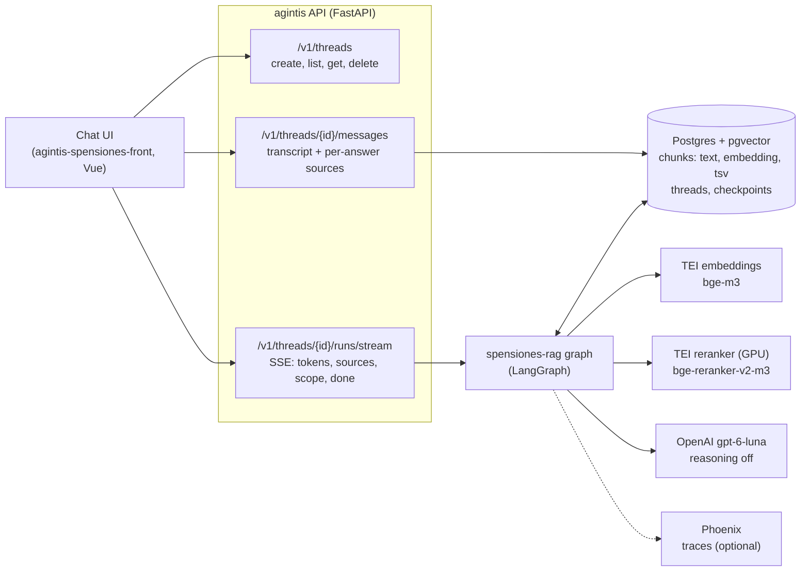
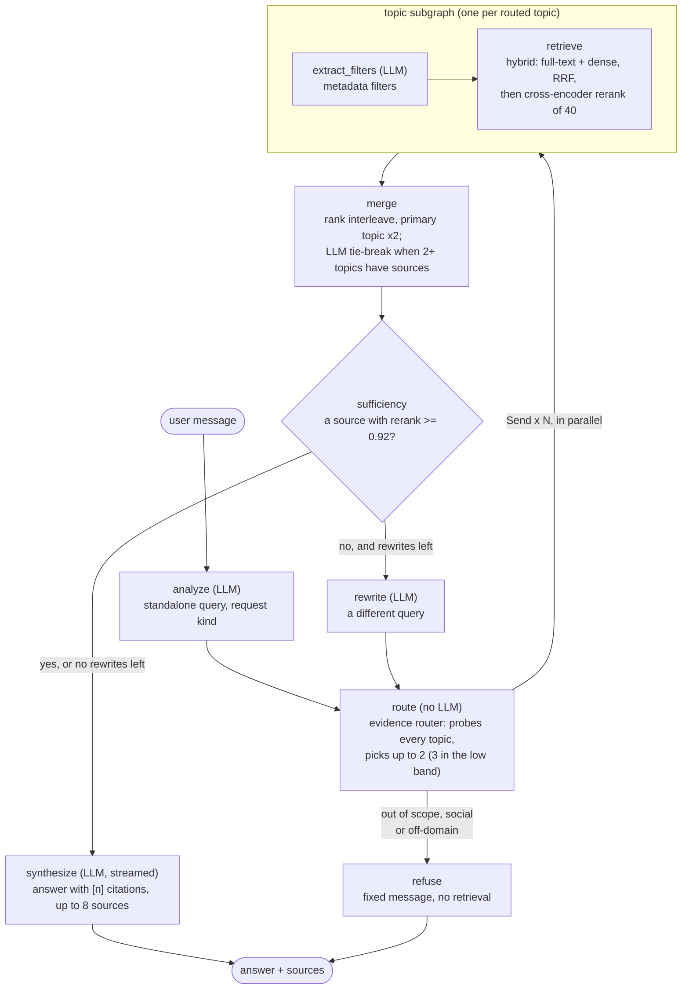
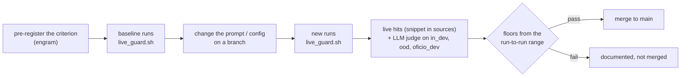

# spensiones: the Chilean pension regulations agent

`spensiones-rag` answers questions about the regulations of the Chilean pension system and
unemployment insurance (Superintendencia de Pensiones), citing the passages it used. Target user:
AFP operations and compliance staff. Agent config: [`agents/spensiones.yaml`](agents/spensiones.yaml);
measurements: [`calibration/README.md`](calibration/README.md).

## System

- One run per thread at a time (a lease); the LangGraph checkpointer keeps the conversation
  (`messages`) and each answer's cited sources (`cited_sources`) in Postgres.
- The tenant comes from `X-Tenant-Id` (or a verified JWT claim); this agent's data is tenant
  `spensiones`.

## One turn

- The scope verdict (`in` / `low` / `out`) comes from the first route of the turn only, from the
  evidence router's cosine score: below 0.4779 is `out` (refused), below 0.6137 is `low` (one
  more topic searched). A rewrite never changes it.
- The rewrite loop keeps the evidence of earlier attempts: it is merged last into the next one.
  `max_rewrites` is 1 on `main`.
- The answer may only use the numbered sources; it keeps each rule's conditions and says it does
  not know when no source covers the question.

## Topics (one retrieval profile each)

| topic | content |
|---|---|
| `compendio` | Compendio de Normas, all Libros: the consolidated, current rules |
| `ncg` | Normas de Carácter General: the changes to the Compendio |
| `circular` | Circulares (1981 on) |
| `resolucion` | Resoluciones exentas |
| `oficio` | Oficios Ordinarios (2001-2024): how the SP resolved concrete cases |
| `jurisprudencia_nota` | Notas Internas (2021-2024) |
| `jurisprudencia_indice` | Index of oficios and dictámenes by subject |
| `articulo_faq` | Help articles for the public, in plain language |

The corpus is crawled from spensiones.cl ([`crawler/`](crawler/)), parsed by the profiles in
[`profiles/`](profiles/) and ingested with `agintis.cli.ingest`.

## How changes are measured

A dump whose log shows a reranker fallback (`Reranker unavailable`) is invalid and redone.

## Status and known gaps (2026-10-24)

Works end to end: chat UI, threads with server-side history, streaming answers with citations,
scope refusal of off-domain questions, multi-topic retrieval with rerank, the rewrite loop.

Known gaps:
- **Sampled sources.** Circulares, NCG, resoluciones and help articles were ingested from a
  35-file sample, not the full listings (2,586 circulares and 483 NCG on spensiones.cl). Help
  articles at full coverage are measured but undecided (calibration README).
- **Colloquial and lay questions.** 77% of a colloquial question bank starts with a weak
  retrieval; most are register gaps (the norms phrase it differently), not missing content.
  A normative-register rewrite did not pass its measurement (see the calibration README).
- **Content outside the corpus.** AFP-internal procedures and systems (fixing a RUT, the
  "canje" in practice) and anything needing the member's own account (balance, projected
  pension, missing months) cannot be answered from the regulations.
- **No clarifying questions.** The thread API supports interrupts, but no production node asks
  the user; an unclear question is answered or refused.
- **Observability of the loop.** Answer dumps record the standalone query, not the rewritten
  queries or how many rewrites ran; cached tokens are not recorded.
- **Non-determinism.** The LLM profile sets no temperature (undocumented for gpt-6-luna):
  identical runs of a rewrite-heavy set varied by 8 hits out of 87.
- **Transcripts.** Threads answered before the transcript endpoint existed have no per-answer
  sources; a failed turn can leave a user message without an answer.
- **Front.** Not yet loading the transcript on reload.
